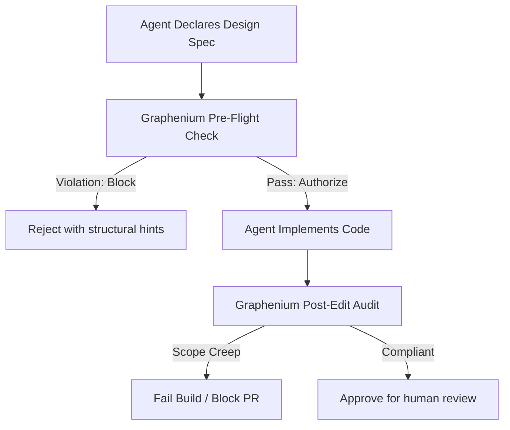

<p align="center">
  
</p>

# The Relational Codebase Compiler & Spec-Driven Containment Engine for AI Coding Agents

**Graphenium (`gm`) compiles a polyglot codebase into a provenance-tagged relational index and mechanically contains AI agents inside an approved architectural contract.**

Graphenium is not a passive search index or a folder-regex linter. It is a local compiler that turns source code into queryable structural facts, then uses those facts to govern what an agent is allowed to write. It replaces blind `grep`/file-read loops with sub-50ms topological queries, and it blocks agents from bypassing service layers, decaying modularity, leaving unproved `sorry` stubs, or editing files outside their declared plan.

**Capability bar:** Tree-sitter + Stack Graphs · Indexed Semi-Naive Datalog · Zero-Config Louvain ΔQ Gating · Virtual AST Workspaces · Lean 4 Proof-Gap & Axiom Auditing · 12 MCP Tools

Standard developer tools help agents find files. Graphenium compiles the system's structure, compresses it for the agent's context budget, and then enforces it as a mechanical write-time contract.

```text
                            Uncontained Agent                         Graphenium-Contained Agent
--------------------------  ----------------------------------------  ----------------------------------------------
Context & search            Blind grep + raw file sweeps              ~85% fewer tokens via compressed AST/Stack-Graphs index
Dependency truth            Fuzzy vector guesses, hallucinated calls  Provenance-tagged EXTRACTED / INFERRED / AMBIGUOUS edges
Design validation           Edits files, hopes tests catch drift      Virtual AST + Datalog + ΔQ pre-flight before disk writes
Modularity                  Silent community decay                    Zero-config Louvain ΔQ gate rejects new topological entropy
Scope                       Quiet edits to unrelated files            Post-edit node/edge/git-diff audit blocks scope creep
Formal verification         Unnoticed sorry/admit stubs, hidden axioms Transitive proof-gap taint + semantic axiom auditing
CI                          Checks only that tests pass               Fails on architectural drift and unrealized specs
```

Binary: `gm`  
Schema: `0.2.0`  
Status: AST + Stack Graphs resolver stable, indexed semi-naive Datalog stable, Virtual AST pre-flight stable, zero-config ΔQ gating stable, post-edit realization auditing stable, Lean 4 proof-gap auditing stable, telemetry overlay experimental

---

## Why Graphenium Exists: The Structural Compilation & Containment Gap

AI coding agents are highly efficient at local edits, but they suffer from **structural blindness and context decay**. Over a long chat session, an agent will lose track of your system instructions and optimize for the path of least resistance (e.g., writing a raw database call inside an HTTP controller to make a local test pass). 

Relying on "soft" guardrails like `CLAUDE.md` or system prompts to maintain design patterns does not work. When context windows get full, these constraints are dropped.

Graphenium establishes **external engineering governance**. It operates outside the LLM context, treating architectural boundaries as a strict, compiled contract. It also attacks the same context decay from the other side: instead of forcing the agent to rediscover structure through tens of thousands of tokens of file reads, Graphenium compiles that structure once and serves it back as compact, provenance-tagged facts.

### The Missing Layer in the Compiler Stack

Autonomous software engineering needs more than syntax, types, and tests. It needs a layer that proves the *shape* of the system still holds after an agent writes code. Graphenium is that layer.

| Layer | Tooling | What It Proves |
|---|---|---|
| **1 - Lexical & Syntactic** | `rustc`, `tsc`, Tree-sitter | Code is syntactically valid. |
| **2 - Type & Memory Safety** | Type checkers, borrow checkers | Local types, signatures, and lifetimes align. |
| **3 - Behavioral Correctness** | `cargo test`, `pytest` | Specific inputs produce expected runtime outputs. |
| **4 - Topological, Architectural & Epistemic Integrity** | **Graphenium (`gm`)** | Transitive architectural invariants hold, Louvain modularity (ΔQ) does not decay, formal proof gaps do not taint verified theorems, and physical diffs match an approved Virtual AST spec. |



---

## The Core Technical Lifecycle: Design-then-Verify

Graphenium enforces an explicit four-phase compiler loop on the agent:

1.  **Declare Intent (Pre-Flight Spec):** Before editing any code, the agent registers its planned changes (classes, methods, and dependencies) in a virtual planning workspace.
2.  **Transitive Policy Solving:** Graphenium's engine runs a local Datalog solver to analyze the proposed virtual AST. If the design bypasses an intermediary architectural layer or uses banned symbols, Graphenium blocks the plan and provides structural feedback.
3.  **Zero-Drift Delta Gating:** Even without a `.graphenium/policy.json` file, Graphenium applies in-memory modularity analysis (ΔQ) and surprise edge profiling to reject plans that mathematically degrade community structure.
4.  **Post-Facto Compliance Audit:** After the agent writes the code, Graphenium parses the physical modifications, checking planned and missing symbols, planned dependency edges, and files modified according to git status or an explicit snapshot diff. It ensures that the agent did not touch files outside the declared scope, introduce unplanned dependencies, or fail to implement its declared spec.

---

## Quick Start

```sh
# 1. Initialize workspace
# Generates .grapheniumignore with standard project defaults
gm init

# 2. Build local AST and Stack Graphs index (No LLM keys required)
gm run . --no-semantic --no-viz

# 3. Diagnose codebase health and import resolution
gm doctor --graph graphenium-out/graph.json --resolution

# 4. Analyze structural neighborhoods
gm query "authentication flow" --budget 2000

# 5. Start the MCP server for AI coding agents
gm serve --graph graphenium-out/graph.json --watch
```

All commands accept `--out-dir <path>` to relocate `graph.json`, `manifest.json`, and reports. `gm run` and `gm watch` also accept `--cache-dir <path>`; configured output/cache directories are excluded from indexing automatically, and persisted paths stay repo-relative so artifacts are portable across machines.

For Lean 4 repositories, `gm trust --axioms <report>` audits theorem dependency cones for `sorryAx`, `native_decide`, external axioms, and binder hypotheses without embedding a Lean compiler. Theorems are classified `UNCONDITIONAL`, `CONDITIONAL`, or `TAINTED`; see [`docs/COMMAND_REFERENCE.md`](docs/COMMAND_REFERENCE.md#gm-trust).

---

## Installation

```sh
# From a local checkout
cargo install --locked --path .

# Or use the platform installer
curl -fsSL https://raw.githubusercontent.com/lambda-alpha-labs/Graphenium/main/install.sh | sh
```
*Requires Rust 1.87 or later. Tree-sitter language grammars are compiled and bundled.*

---

## Five Technical Pillars

### Pillar 1: Deterministic Polyglot Compilation & Epistemic Provenance
Graphenium compiles 10 languages - Rust, Python, Go, TypeScript, JavaScript, Java, C, C++, C# (including recursive `.sln`/`.csproj` assembly and project-reference discovery), and Lean 4 - into a unified relational index (`schema 0.2.0`) using Tree-sitter and import-scoped Stack Graphs resolution.

For agents, this replaces 30,000-token brute-force `grep`/file-read loops with ~1,500-token topological queries (PageRank hotspots, Brandes betweenness bottlenecks, blast radius, and safest paths). Every relationship carries explicit provenance:
*   `EXTRACTED` **(AST-Proven):** Compiler-backed facts (imports, type inheritance, explicit call signatures). Safe planning backbone.
*   `INFERRED` **(Heuristics):** Semantic leads that the agent is forced to verify against source.
*   `AMBIGUOUS` **(Collisions / Proof Gaps):** Identifier collisions that force the agent to halt and inspect source files directly, plus Lean 4 `sorry` / `admit` proof gaps and semantic `#print axioms` findings (`sorryAx`, external axioms, `native_decide` shortcuts) that must be resolved before a theorem is treated as verified.

### Pillar 2: Intent–Implementation Decoupling via Virtual AST Workspaces
Before touching disk, the agent declares its proposed classes, functions, and dependency edges in an in-memory planning workspace (`create_planning_workspace`, `add_planned_symbol`). Graphenium models the future topology of the repository in milliseconds. If the design violates an invariant, the agent receives an exact topological counterexample *in memory* before wasting thousands of tokens rewriting physical files - eliminating the "agent linter deadlock" loop.

### Pillar 3: Embedded Semi-Naive Datalog Verification Engine
Graphenium compiles the codebase and Virtual AST into strongly typed EDB relations (`node`, `calls`, `imports`, `inherits`, `implements`, `contains`, `degree`, `hub`) and evaluates first-order rules (`stdlib.dl`) with goal-directed pruning, stratified negation, SCC-ordered strata, semi-naive delta iteration, and full-tuple plus per-column hash indexes (up to 10M EDB facts within a bounded step budget).

Beyond simple folder rules, `stdlib.dl` proves:
*   Multi-hop transitive layer bypasses (`bypasses_layer(X, Y, Z)`).
*   Mutual recursion and cycles (`circular_dependency(X, Y)`).
*   Call-site container/member aliasing hazards (`aliased_container_call(Caller, Target, Container, Member)`).
*   Entry-point dead-code and unreachability (`unreachable_from(Entry, Node)`).
*   Transitive formal proof-gap taint propagation (`has_proof_gap(X)` and `tainted_by_proof_gap(X)`).
*   Lean trust boundaries from semantic `#print axioms` ingestion (`uses_axiom/2`, `has_untrusted_axiom/1`, `has_native_decide/1`, `untrusted_theorem/1`) plus binder-hypothesis propagation (`depends_on_hypothesis/2`, `inherits_hypothesis/2`, `conditional_theorem/1`).

Query bodies support `!=` / `/=` constraints (after positive bindings), stratified `not` with explicit rejection of unstratifiable recursion, and several labelled `?-` blocks that share a single materialized EDB/index. `gm query --datalog ... --json` emits the `datalog.v1` report for CI and tooling.

### Pillar 4: Zero-Config Topological Entropy Guardrails (Louvain ΔQ + Surprise Profiling)
Even with **zero configuration files** (no `.graphenium/policy.json`), Graphenium partitions the physical baseline subgraph (`G_baseline`) and the proposed Virtual AST overlay (`G_virtual`) in memory, runs deterministic Louvain community detection on both, computes the modularity delta (`ΔQ = Q(G_virtual) − Q(G_baseline)`), and scores planned edges for structural surprise (`cross-community`, `peripheral→hub`).

This solves the "legacy codebase paradox": Graphenium accepts existing architectural complexity as baseline reality while mechanically blocking agents from introducing *new* topological entropy. Available via `validate_plan` (MCP, always runs the delta gate) and `gm check --delta --plan <id>` (CLI).

### Pillar 5: Closed-Loop Post-Edit Realization & Scope-Creep Auditing
After physical edits are made and the index is refreshed, `gm check --plan <id>` and the MCP `verify_changes` tool audit physical reality against the approved Virtual AST spec across three dimensions:
*   **Realized vs. missing nodes:** Did the agent implement every declared symbol?
*   **Realized vs. missing edges:** Did the physical code realize the declared dependency relationships?
*   **Unplanned file modifications (scope creep):** Did the agent touch any non-test files outside the declared plan scope, according to git status or an explicit snapshot diff?

For PR-level containment, `gm gate --diff <before> <after>` blocks merges that introduce critical architectural drift between snapshots.

### Declarative Structural Governance
Explicit rules remain available for teams that need them. Declare contracts in `.graphenium/policy.json` at the root of your repository:

```json
{
  "rules": [
    {
      "type": "forbidden_dependency",
      "from_pattern": "src/controllers/**",
      "to_pattern": "src/db/**",
      "reason": "Controllers must use services, not access DB directly"
    },
    {
      "type": "strict_layering",
      "layers": [
        "src/serve/**",
        "src/analyze/**",
        "src/extract/**",
        "src/model/**"
      ],
      "reason": "Respect tiered architecture: serve -> analyze -> extract -> model"
    }
  ]
}
```

Use `gm check --plan <id> --strict` to run pre-flight policy checks and post-facto compliance audits in CI.

```sh
# Topological delta gate (zero-config modularity protection)
gm check --delta --plan <id>
```

For PR-level containment, compare two compiled indexes with `gm gate`:

```sh
gm gate --diff graphenium-snapshots/before.json graphenium-out/graph.json
```

Without `--diff`, `gm gate` runs the standard trust check against `graphenium-out/graph.json`.

---

## Technical Safeguards: Friction & Loop Mitigations

Traditional static analysis tools and natural-language guardrails (like `CLAUDE.md` or system prompts) fail when context windows fill up, leading to agent "vibe-coding" and rapid token consumption. Graphenium implements three structural safeguards to prevent developer friction and agent deadlock:

### 1. Mitigating the "Agent Deadlock" Loop (Pre-Flight Virtual ASTs)

* **The Friction:** If an agent is blocked by a strict linter, it can fall into a token-wasting trial-and-error cycle (Propose → Blocked → Tweak → Blocked).
* **Graphenium's Mechanism:** Graphenium prevents this loop by isolating change evaluations to a virtual planning workspace (`create_planning_workspace`). The agent registers its intent - classes, methods, and imports - before editing any physical files. Graphenium's pre-flight solver evaluates this virtual AST in milliseconds.
* If a violation is found, the agent does not receive a vague natural-language rejection. It receives structured, compiler-proven topological path violations (e.g., demonstrating the exact transitively bypassed service layers). This allows the agent to correctly refactor its design plan in memory before wasting LLM tokens on physical file rewrites.

### 2. Solving "Policy Rot" (Zero-Config Topological Delta Gating)

* **The Friction:** Declaring and maintaining strict architectural rules in a static JSON file (`policy.json`) introduces manual configuration overhead that fast-moving teams often neglect.
* **Graphenium's Mechanism:** If no `.graphenium/policy.json` file is present in the repository, Graphenium dynamically falls back to **Zero-Drift Delta Gating** (`gm check --delta`). Instead of relying on static directory regexes, Graphenium uses its native Louvain community-detection engine to evaluate your codebase's current structural cohesion.
* When an agent proposes a virtual plan, Graphenium calculates the modularity delta (ΔQ) and surprise coupling score of the new edges. It gracefully accepts your existing legacy complexity as the baseline, but mechanically blocks the agent from introducing *new* topological decay. No configuration files are required to protect your system's modularity.

### 3. Resolving Agent Integration Friction (Direct Skill-Folder Injection)

* **The Friction:** Standard stateless MCP setups mean agents can easily bypass sequential four-phase design loops (Declare → Solve → Gate → Audit), requiring manual developer mediation.
* **Graphenium's Mechanism:** Graphenium circumvents this integration barrier by programmatically injecting its behavioral rules directly into the agentic runtime. During installation (`install.sh` or `install.ps1`), Graphenium copies its standard system skill instruction set (`skills/graphenium/SKILL.md`) directly into Claude Code's native skill directory (`~/.claude/skills/graphenium/SKILL.md`).
* This ensures that the moment the assistant handshakes with Graphenium, it ingests explicit, structured operating parameters on how to manage virtual workspaces and resolve topological violations, without requiring the developer to configure system prompts manually.

---

## Language Support

Graphenium supports mixed repositories with Rust, Python, Go, JavaScript, TypeScript, Java, C, C++, C#, and Lean 4.

C# projects receive build-boundary awareness through recursive `.sln` and `.csproj` discovery, enabling Graphenium to model assemblies, namespaces, and project references as structural boundaries even in deeply nested enterprise layouts.

Lean 4 support is built in and requires no tree-sitter grammar feature flag. It extracts namespaces, declarations, imports, and proof dependencies, and emits `AMBIGUOUS` `unverified_sorry` edges for `sorry` / `admit` proof gaps so CI can gate incomplete formal verification work. It also emits `depends_on_hypothesis` edges for theorem/lemma/def binder types, so a kernel-clean theorem that takes `(h : Cert)` is reported as `CONDITIONAL` rather than passing silently. For semantic trust boundaries, `gm run --lean-axioms <report>` bakes `#print axioms` facts into the graph (or `--run-lean-axioms <file>` explicitly invokes `lake env lean`), and `gm trust` audits inherited kernel axioms, external axioms, `native_decide` shortcuts, and hypotheses through the full dependency cone.

---

## MCP Setup

Integrate Graphenium directly into your agent's execution loop. For tools that spawn MCP from the project directory, use the `scripts/graphenium-mcp` launcher (rebuilds only when the index is missing, keeping startup instantaneous).

```sh
install -m 755 scripts/graphenium-mcp ~/.local/bin/graphenium-mcp
```

### Claude Code
```sh
claude mcp add graphenium --scope user -- gm serve --graph /path/to/graphenium-out/graph.json --watch
```

### Grok
Configure in `~/.grok/config.toml`:
```toml
[mcp_servers.graphenium]
command = "/Users/<you>/.local/bin/graphenium-mcp"
args = []
enabled = true
```

### Cursor
Add to `~/.cursor/mcp.json`:
```json
{
  "mcpServers": {
    "graphenium": {
      "command": "gm",
      "args": ["serve", "--graph", "/path/to/graphenium-out/graph.json", "--watch"]
    }
  }
}
```

---

## Detailed Documentation Map

### Root
| Document | Purpose |
|---|---|
| [`AI_SETUP.md`](AI_SETUP.md) | Step-by-step assistant setup playbook. |
| [`CONTRIBUTING.md`](CONTRIBUTING.md) | Contributor guidelines and module reference. |
| [`CHANGELOG.md`](CHANGELOG.md) | Release history and milestone summary. |
| [`SECURITY.md`](SECURITY.md) | Local-first security guarantees and vulnerability reporting. |
| [`MANIFEST.md`](MANIFEST.md) | Complete package manifest indexing all documentation. |

### Core Documentation (`docs/`)
| Document | Purpose |
|---|---|
| [`docs/GETTING_STARTED.md`](docs/GETTING_STARTED.md) | Installation, initial codebase indexing, and MCP setup. |
| [`docs/AGENT_WORKFLOWS.md`](docs/AGENT_WORKFLOWS.md) | Containment workflows: pre-flight, in-edit planning, and verification. |
| [`docs/CI_AND_GOVERNANCE.md`](docs/CI_AND_GOVERNANCE.md) | Enforcing architecture policies in CI pipelines. |
| [`docs/COMMAND_REFERENCE.md`](docs/COMMAND_REFERENCE.md) | Complete CLI syntax and configuration arguments. |
| [`docs/MCP_TOOLS.md`](docs/MCP_TOOLS.md) | Behavior specifications for MCP clients. |
| [`docs/ARCHITECTURE.md`](docs/ARCHITECTURE.md) | Indexing pipelines, C# project references, and Datalog evaluation. |
| [`docs/TRUST_MODEL.md`](docs/TRUST_MODEL.md) | Under-the-hood details of AST-proven vs heuristic confidence. |
| [`docs/BENCHMARKING.md`](docs/BENCHMARKING.md) | Performance metrics: latency, token budgets, and scaling limits. |
| [`docs/COMPARISON.md`](docs/COMPARISON.md) | Why Graphenium supersedes grep, AST tools, GraphRAG, and static architecture linters. |
| [`docs/HARNESS_ADAPTER.md`](docs/HARNESS_ADAPTER.md) | Embedding Graphenium's relational compiler and containment engine as a library. |
| [`docs/WORKED_EXAMPLES.md`](docs/WORKED_EXAMPLES.md) | Case studies proving containment on real repositories. |
| [`docs/GRAPH_REPORT.md`](docs/GRAPH_REPORT.md) | Interpreting the generated codebase audit report. |
| [`docs/DOCUMENTATION_MAP.md`](docs/DOCUMENTATION_MAP.md) | Full documentation ecosystem overview. |

### Agent Integration
| Document | Purpose |
|---|---|
| [`skills/graphenium/SKILL.md`](skills/graphenium/SKILL.md) | Agentic skill instructions and containment behavior rules. |
| [`contrib/harness-adapter/README.md`](contrib/harness-adapter/README.md) | Embedding Graphenium's engine inside AI coding harnesses. |

### Case Studies (`worked/`)
| Document | Purpose |
|---|---|
| [`worked/README.md`](worked/README.md) | Overview of structural containment case studies. |
| [`worked/TEMPLATE.md`](worked/TEMPLATE.md) | Template for documenting new codebase case studies. |
| [`worked/graphenium-self-analysis/README.md`](worked/graphenium-self-analysis/README.md) | Graphenium self-analysis: applying the containment engine to itself. |
| [`worked/graphenium-self-analysis/sample-queries.md`](worked/graphenium-self-analysis/sample-queries.md) | Sample query output on Graphenium's own codebase. |
| [`worked/flt-lean4-proof-gaps/README.md`](worked/flt-lean4-proof-gaps/README.md) | Lean 4 proof-gap taint mapping and a verified `sorry` proof in Buzzard's Fermat's Last Theorem repository. |
| [`worked/mub6-dimension-six/README.md`](worked/mub6-dimension-six/README.md) | Exact dimension-six MUB obstructions: 16 bases with no MUB pair, plus a 90-vector set with no orthogonal pair, checked by exact arithmetic, Lean, and Graphenium's embedded Datalog. |

---

## Contact & Enterprise

*   Issues and Feature Requests: [GitHub Issues](https://github.com/lambda-alpha-labs/Graphenium/issues)
*   Security Reports: security@graphenium.dev
*   Design partners, enterprise pilots, and partnerships: hello@graphenium.dev

---

## License

MIT. See [`docs/LICENSE.md`](docs/LICENSE.md).