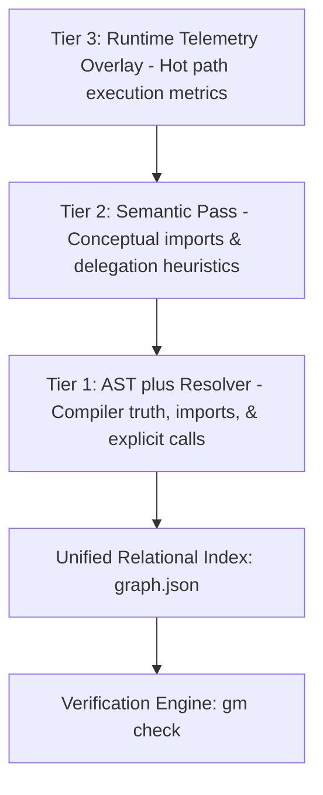
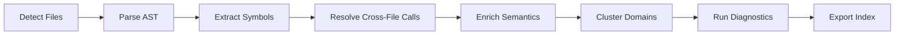

# Graphenium System Architecture

Graphenium is a local relational codebase compiler and spec-driven containment engine for AI coding agents. It is not a passive code search index, a visualizer, or a folder-regex linter.

Its architecture serves two reinforcing goals. First, it compiles a polyglot codebase into a provenance-tagged relational index so agents can replace blind `grep`/file-read loops with compact, sub-50ms structural queries. Second, it uses that same index to mechanically govern write-time behavior: pre-flight Virtual AST validation, embedded Datalog invariant solving, zero-config Louvain modularity (ΔQ) gating, Lean 4 proof-gap and semantic axiom auditing, and post-edit realization/scope audits before changes are committed.

### Layer 4 of the Verification Stack

Graphenium is the **topological, architectural, and epistemic integrity layer** above the three conventional verification layers:

| Layer | Tooling | What It Proves |
|---|---|---|
| **1 - Lexical & Syntactic** | `rustc`, `tsc`, parsers | Syntactic validity. |
| **2 - Type & Memory Safety** | Type and borrow checkers | Local signatures and lifetimes align. |
| **3 - Behavioral Correctness** | `cargo test`, `pytest` | Inputs produce expected outputs. |
| **4 - Topological, Architectural & Epistemic Integrity** | **Graphenium** | Transitive invariants hold, ΔQ does not decay, proof gaps do not taint verified theorems, and diffs match the approved Virtual AST. |

---

## 1. The Three-Tier Codebase Indexing Model

To balance compile-time speed, semantic depth, and runtime relevance, Graphenium organizes codebase metadata into three tiers:



### Tier 1: AST plus Resolver (Compiler Truth)
This is Graphenium's core foundation. It runs entirely offline, requiring no remote API calls. 
*   **AST Parsing:** Graphenium uses local Tree-sitter parsers to extract code symbols (classes, structs, functions, interfaces, methods) directly from source files.
*   **Resolution Engine:** Our cross-file reference resolver builds an export index and binds imports, uses, and calls across file boundaries. When a symbol name collides across files, it narrows candidates using the caller's explicit imports (and same-directory scoping where applicable) before binding, preserving the unique-survivor trust guarantee.
*   **Boundary Parsing:** For C# environments, Graphenium recursively discovers Visual Studio `.sln` and `.csproj` files to model compiled assembly boundaries and namespaces. For Lean 4, a native pure-Rust extractor models namespaces, declarations, imports, and proof dependencies.

### Tier 2: Semantic Pass (Conceptual Enrichment)
An optional, remote pass that uses LLMs (such as Claude, GPT-4o, or DeepSeek) to identify high-level design relationships that static compilers miss. It infers conceptual dependencies, delegation patterns, and architectural intent.

### Tier 3: Telemetry Overlay (Runtime Context)
An experimental runtime overlay that imports OpenTelemetry JSON trace files. It overlays call counts, P95 latencies, and execution frequencies onto Graphenium's static AST index, enabling agents to identify and protect production hot-paths.

---

## 2. The Relational Codebase Schema (v0.2.0)

Graphenium compiles your codebase into a structured relational index stored as a local `graph.json` file. The schema consists of:

| Element | Description | Examples |
|---|---|---|
| **Nodes** | Unique code entities and structural containers. | files, modules, classes, structs, functions, methods, test suites, build targets, package managers, and rationale documents. |
| **Edges** | Directed relationships between nodes. | imports, contains, calls, uses, inherits, implements, tests, and depends_on. |
| **Hyperedges** | N-ary relationships grouping 3 or more nodes. | Multi-module service participation or cross-file shared design patterns. |
| **Domains** | Louvain-partitioned cohesive architectural clusters. | Folders or packages with high internal coupling and minimal external exports. |

---

## 3. The AST-Proven Provenance Model

Graphenium enforces an explicit trust model on every relationship in the index. Each edge carries metadata defining its origin, confidence, and validation status:

```text
EXTRACTED + resolved: AST-proven compile truth  -> Safe to plan against
INFERRED  + inferred: Semantic guess             -> Treat as a hypothesis (verify)
AMBIGUOUS + ambiguous: Multi-target collision or proof gap -> Stop and inspect source code
```

*   **`extractor`:** Which module generated the edge (e.g., `tree-sitter`, `tree-sitter-stack-graphs`, `llm`, `csproj-parser`).
*   **`resolution_status`:** Whether the target is a concrete node present in the index (`resolved`, `unresolved`, `heuristic`).
*   **`confidence`:** The trust classification of the edge (`EXTRACTED`, `INFERRED`, `AMBIGUOUS`).

---

## 4. The Codebase Compilation & Indexing Pipeline

When you run `gm run`, Graphenium executes a highly concurrent indexing pipeline:



1.  **File Detection:** Walks the project root, respects `.gitignore` and `.grapheniumignore`, and filters out sensitive credentials or keys.
2.  **AST Parsing:** Uses parallel rayon worker threads to parse code files into tree-sitter ASTs. Rust, Go, and Lean 4 use dedicated extractors; other supported languages use the configured generic walker.
3.  **Cross-File Resolution:** Resolves imports and binds behavior calls using a local Stack Graphs-style binder with import-scoped disambiguation for colliding symbol names.
4.  **Semantic Inference:** (Optional) Batches uncached text and image files through remote LLM endpoints to extract high-level conceptual boundaries.
5.  **Cohesion Partitioning:** Runs a native Louvain community clustering algorithm to partition the index into structural folder domains.
6.  **Hotspot & Anomaly Analysis:** Calculates centrality metrics (PageRank, betweenness centrality) and anomaly scores (Surprise Connections) to identify architectural erosion.
7.  **Diagnostic Export:** Writes the complete index to `<out-dir>/graph.json` and compiles a human-readable `GRAPH_REPORT.md`.

### Portable Workspaces and Content-Addressed Manifests

`--out-dir` relocates `graph.json`, `manifest.json`, reports, and the default cache; `--cache-dir` separates extraction caches. Both directories are excluded from the corpus walk, so a custom output directory is never indexed as source. Every persisted path (`Node.source_file`, `Edge.source_file`, manifest keys, AST-cache payloads) passes through `detect::path::to_repo_relative`, which strips the project root and normalizes separators. This keeps artifacts portable across machines and CI runners.

The manifest is content-addressed: each entry records `mtime`, `sha256`, and `byte_len`. `is_changed_fast` trusts matching mtime/size and falls back to SHA-256 when mtimes drift (fresh checkout, `git switch`); `is_changed_strict` always hashes. `gm check --verify-fresh` / `gm gate --verify-fresh` use the strict predicate read-only to detect stale graphs; `gm run --no-cache-write` skips cache writes for ephemeral jobs.

AST cache entries are keyed by extractor format version, crate version, and content SHA-256. Because a cache written by an older gm could lack newer edges (for example `depends_on_hypothesis`), `gm run` prunes entries whose key prefix belongs to another gm/extractor version instead of replaying them after an upgrade.

---

## 5. C# Compilation Boundary & Namespace Resolution

Enterprise C# codebases often have complex build boundaries that do not align with folder layouts. Graphenium recursively discovers `.sln` and `.csproj` configurations at any depth (while respecting `.gitignore`, `.grapheniumignore`, and skip directories) to capture:
*   Project references and compilation dependencies.
*   Assembly output names and Root Namespace definitions.
*   Inheritance chains and interface contracts (`inherits`, `implements`) from AST `base_list` structures.

This ensures that AI agents can reason about C# assemblies and namespace scopes, preventing them from introducing invalid cross-project dependencies in Visual Studio solutions - including projects nested under paths like `src/Services/Billing/Billing.Api.csproj`.

---

## 5.1 Lean 4 Formal Verification Extraction

Graphenium indexes Lean 4 `.lean` files with a native pure-Rust extractor (`src/extract/lean.rs`), requiring no external tree-sitter grammar. It captures:
*   `import Foo.Bar` declarations as `imports` edges.
*   `namespace ... end` scopes, producing qualified labels such as `Verification.main_safety`.
*   `theorem`, `lemma`, `def`, `abbrev`, `structure`, `class`, `inductive`, `axiom`, and `opaque` declarations with exact source spans.
*   Body identifier references as intra-file `calls` edges, or unresolved cross-file references for the Stack Graphs resolver.
*   Incomplete proofs containing `sorry` or `admit`, emitted as `AMBIGUOUS` `unverified_sorry` self-edges.

The proof-gap edges feed `gm check --max-ambiguous`, so CI can mechanically block unproved theorems. The standard library also exposes `has_proof_gap(X)` and `tainted_by_proof_gap(X)` for transitive proof-gap taint analysis.

### 5.2 Semantic Axiom Auditing (`#print axioms`)

The token-based extractor above is complemented by an opt-in semantic ingestion path (`src/extract/lean_axioms.rs`). Graphenium never embeds or invokes a Lean compiler by default. Instead it accepts either raw `#print axioms` text or a `lean-axioms.v1` JSON document (`schema_version`, `source_hash`, `declarations[]`) produced externally. `gm run --lean-axioms <path>` bakes the report into the graph, and `--run-lean-axioms <file>` explicitly opts in to running `lake env lean <file>`. Declarations may also carry `binders[]` or an elaborated `ConstantInfo.type` (`forallE`) expression; Graphenium flattens those binders into `depends_on_hypothesis` edges, which captures implicit/section hypotheses that a line-oriented source scan cannot see.

Axioms are classified into four buckets:

| Class | Examples | Graph effect |
|---|---|---|
| `standard_kernel` | `propext`, `Classical.choice`, `Quot.sound` | `depends_on_axiom` (`INFERRED`) |
| `incomplete_proof_gap` | `sorryAx` | `unverified_sorry` (`AMBIGUOUS`) |
| `native_eval_shortcut` | `Lean.ofReduceBool`, `Lean.trustCompiler` | `unverified_native_decide` (`AMBIGUOUS`) |
| `external_axiom` | User `axiom`s, certificate axioms | `depends_on_axiom` (`AMBIGUOUS`) |

This closes the syntactic-proof-gap blind spot: a theorem may contain no `sorry` token yet still depend on a user axiom or `native_decide`. `gm trust` resolves the transitive dependency cone, reports inherited axioms by class, and exits non-zero on disallowed external axioms, `sorryAx`, or (with `--forbid-native-decide`) native-decision shortcuts. Reports are canonicalized by axiom key, so `Quot.sound` / `quot_sound` and `Classical.choice` / `classical_choice` render once using Lean's spelling. `--json` emits exactly one `lean-trust.v1` document on stdout (with `failure_reasons` on failure), keeps stderr clean, and communicates the gate result through the exit code. Datalog exposes the same facts as `uses_axiom/2`, `has_untrusted_axiom/1`, `has_native_decide/1`, and `untrusted_theorem/1`, plus hypothesis propagation via `depends_on_hypothesis/2`, `inherits_hypothesis/2`, and `conditional_theorem/1`.

The extractor also records binder hypotheses. A declaration such as `theorem T (h : EdgeAtlasCertificate) : Goal` receives a `depends_on_hypothesis` edge to `EdgeAtlasCertificate` when that type is a project-defined structure, class, inductive, or opaque declaration; binder types that resolve to a transparent `def`/`abbrev` are ordinary data and are not flagged. Detection spans multi-line signatures, active `section`/`namespace` `variable` declarations, and cross-file certificate types; raw Lean spellings are preserved so the cross-file resolver can bind them. Square-bracket typeclass constraints (`[CommRing R]`) and primitive data parameters (`(n : Nat)`) are deliberately excluded. `gm trust` propagates these edges transitively and classifies the theorem as `UNCONDITIONAL`, `CONDITIONAL`, or `TAINTED`; conditional theorems fail CI unless their assumptions are allowed with `--allow-hypothesis` or `.graphenium/policy.json`. Datalog exposes `depends_on_hypothesis/2`, `inherits_hypothesis/2`, and `conditional_theorem/1`.

---

## 6. Planning Workspaces & The Virtual AST Spec

To support Graphenium's "Design-then-Verify" loop, the index supports an optional `plan_id` field. This allows Graphenium to maintain a **Virtual AST** representing the agent's proposed changes, decoupled from the actual, physical code on disk:

```text
Proposed Plan (Virtual AST)   ----->   Evaluated against .graphenium/policy.json
         |                              + Dynamic Delta Gating (zero-config fallback)
         v (Approved)
Physical Implementation      ----->   gm check --plan compares physical to virtual
```

By maintaining a virtual-to-physical mapping, Graphenium mechanically detects all three post-edit compliance dimensions enforced in `v0.21.0`:
*   **Implemented vs. Missing Nodes:** Successfully written classes and methods that match the approved design, and declared symbols the agent failed to implement.
*   **Implemented vs. Missing Edges:** Declared dependency relationships that were physically realized, and planned edges that never appeared in the compiled AST.
*   **Scope Creep / Unplanned Edits:** Files modified by the agent that were not declared in the pre-flight plan, detected via git status or an explicit snapshot diff (with test-file allowances and override support).

---

## 7. Dual-Graph Delta Solver (`src/analyze/delta.rs`)

Graphenium's **Topological Entropy Guardrails** implement a dual-graph partition pipeline. The delta engine (`evaluate_delta_gate`) operates entirely in memory on the loaded index.

### Graph Partitioning

```text
G_full      = loaded index (physical + all planning workspaces)
G_baseline  = extract_baseline_subgraph(G_full)
              └── nodes/edges where plan_id is None (physical-only)
G_virtual   = G_baseline ∪ planned subgraph for target plan_id
              └── physical nodes + edges + plan_id-scoped virtual nodes/edges
```

Both subgraphs are independently re-clustered via Louvain (`src/cluster/louvain.rs`) with `ClusterOptions::default()` (seed 42). Community IDs are written back to each subgraph's nodes before modularity is computed.

### Modularity Delta (ΔQ)

For each subgraph, Graphenium builds an internal `LGraph` adjacency representation and computes modularity Q over the community assignment vector:

```text
ΔQ = Q(G_virtual) - Q(G_baseline)
```

The gate passes when `ΔQ ≥ modularity_tolerance` (default: `-0.02`). A negative ΔQ means the proposed plan weakens community cohesion relative to the current physical baseline.

### Surprise Edge Filtering

After clustering `G_virtual`, Graphenium scores all edges via `surprising_connections()` (`src/analyze/surprise.rs`) and filters to **plan-attributed edges only**:

1. Score every edge in `G_virtual` (top 50 by surprise).
2. For each candidate, check `edges_between(source, target)` for an edge with `plan_id == target_plan`.
3. Retain edges where `score ≥ surprise_threshold` (default: `5.0`).

Surprise factors include confidence tier, cross-file-type, cross-repo directory, `cross-community`, semantic similarity, and `peripheral→hub` coupling. Only edges introduced by the planning workspace are reported - existing physical shortcuts are accepted as baseline complexity.

### Drift Detection

`detect_drift(G_baseline, G_virtual)` (`src/cluster/drift.rs`) compares community assignments and cross-boundary edge counts. Events are filtered to plan-attributed nodes plus aggregate `cross-boundary` and `community-structure` markers.

**Entry points:** `validate_plan` with `skip_policy_rules = true` (MCP delta gate), `validate_plan` (orchestrator and full policy gate), `gm check --delta --plan <id>` (CLI).

---

## 8. Embedded Datalog Policy Solver

Before an agent edits code, Graphenium runs its proposed design plan through a local **Datalog inference engine** (`src/analyze/query.rs`). 

Graphenium parses your `.graphenium/policy.json` rules and translates them into Datalog query constraints. It then runs Graphenium's compiled Datalog standard library (`src/analyze/query/stdlib.dl`) over the virtual AST to mathematically prove boundary violations:

*   **`forbidden_dependency`:** Proves if any direct path is proposed from a banned glob pattern to another (e.g., `src/routes/**` directly referencing `src/db/**`).
*   **`strict_layering`:** Proves if any path violates a layered hierarchy (e.g., `repositories` attempting to import a `controller` class). Transitive, multi-hop bypasses are proven using the transitive dependency closure:
    ```prolog
    bypasses_layer(X, Y, Z) :-
        depends_transitive(X, Z),
        not depends_transitive(X, Y).
    ```
*   **`banned_symbol`:** Proves if the agent attempted to introduce or call a restricted module (e.g., direct raw SQL utilities).

### Evaluation Strategy

The solver uses goal-directed rule selection, terminal-first backtracking joins, and semi-naive delta relations so recursive rules only join newly derived tuples. Fully-ground existence goals stop as soon as every goal atom is satisfied.

Negation is **stratified**. Graphenium builds the predicate dependency graph over all rules reachable from the query goals, partitions predicates into strongly connected components, and evaluates strata in dependency order. A recursive cycle containing a negative edge is rejected with an explicit validation error instead of being evaluated to a non-terminating fixpoint. Lower strata are materialized before any higher stratum that negates them, so every `not p(...)` sees a frozen relation.

Frozen relations maintain a full-tuple `HashSet` for ground checks and bound-mask hash indexes for partially bound joins. Positive body atoms are indexed the same way, using the columns already bound by earlier atoms, so a two-atom join such as `p(A,C) :- e(A,B), e(B,C)` no longer scans `e` once per outer tuple; an atom with no bound column iterates its relation directly. A mask covers the exact set of columns that are constant or already bound, so neither positive joins nor negation fall back to a linear scan regardless of which column (leading or not) participates. Query bodies also reorder positive atoms ahead of `not` and `!=` filters; a named variable that appears only in a negated atom is rejected by range-restriction validation. The 200k-edge `e(A,B), not e(B,A)` regression runs within the 1s release budget.

Query syntax supports negation (`not` / `!`), inequality (`A != B` / `A /= B`), and multiple labelled `?-` blocks. Inequality constraints are evaluated only after all positive body atoms have bound their variables; an ungrounded inequality is a validation error. Multiple `?-` queries share one materialized EDB/IDB and one step budget, and `gm query --datalog ... --json` returns the `datalog.v1` report. Only EDB relations reachable from the goals are materialized. Output is goal-only by default: each `?-` goal produces its own result set, and `--show-derived` optionally adds every materialized IDB relation under `derived[]`.

### Verification Predicates

Beyond architectural policy helpers, `stdlib.dl` includes:

*   `contains_transitive(X, Y)` - recursive containment closure.
*   `aliased_container_call(Caller, Target, Container, Member)` - detects calls that depend on both a container and a member transitively contained inside it.
*   `unreachable_from(Entry, Node)` - finds symbols not transitively reachable from an entry point.
*   `has_proof_gap(X)` / `tainted_by_proof_gap(X)` - detects Lean `sorry`/`admit` gaps and propagates taint through dependency chains.
*   `uses_axiom(Decl, Axiom)` / `has_untrusted_axiom(X)` / `has_native_decide(X)` / `untrusted_theorem(X)` - audits semantic `#print axioms` facts, including non-kernel and `native_decide` trust shortcuts.
*   `depends_on_hypothesis(X, H)` / `inherits_hypothesis(X, H)` / `conditional_theorem(X)` - detects binder hypotheses and propagates them transitively, so kernel-clean conditional theorems are queryable.
*   Inequality constraints (`A != B` / `A /= B`) are first-class body items; they are evaluated after positive bindings and rejected when a variable is ungrounded.

---

## 9. Structural Domain Analysis & Anomaly Detection

Graphenium implements advanced network analysis algorithms to identify architectural decay:
*   **Betweenness Centrality:** Runs Brandes' algorithm to identify bottleneck symbols. These are critical "bridge" components; modifying them carries high risk because they connect otherwise isolated module domains.
*   **PageRank Centrality:** Ranks symbols by reference popularity, highlighting highly depended-on hotspots.
*   **Surprise Connections:** Scores relationships based on how unexpected they are. Connections that bridge different communities, cross folder domains, or link low-degree peripheral nodes directly to high-degree hotspots are flagged as architectural anomalies.

---

## 10. Current Technical Limitations

| Limitation | Structural Impact | Automated Mitigation |
|---|---|---|
| **Dynamic Dispatch & Reflection** | Purely static analysis may miss runtime dependency injections. | Use Graphenium's **optional semantic pass** or import **runtime telemetry traces** to overlay execution paths. |
| **Contextual Ambiguity** | Identical names in different folders can create identifier collisions. | Graphenium enforces the use of **qualified labels** and namespace scoping to distinguish identically named classes. |
| **No Source-Code Mutation** | Graphenium is a gating layer; it does not write code edits. | Run Graphenium directly inside git commit hooks or CI pipelines to block bad agentic output before merge. |
| **Syntactic Proof Gaps** | The default Lean extractor is token-based; custom axioms, binder hypotheses, or tactics that conceal incompleteness may not be flagged without semantic input. | Ingest `#print axioms` explicitly (`gm run --lean-axioms`, `gm trust`) and use hypothesis-aware trust (`--allow-hypothesis`, `.graphenium/policy.json`) so `sorryAx`, external axioms, `native_decide` shortcuts, and unconstructed structure parameters become graph facts. |
